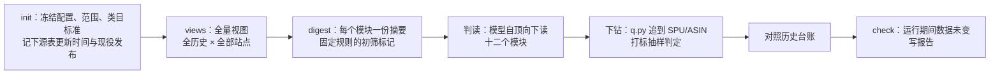

# monthly-acceptance

**月度大盘数据验收 Skill · 0.1.1**

服务商每月把爬虫加算法估出的市场数据全量重推到 Doris `internal.flywheel.monthly_sales_wide`（平台类目 + AI 标准类目 + 属性标签合在一张表）。这个 Skill 自顶向下判断这批数能不能信、哪里不能信、对我们用的数影响多大，交付一篇文字验收报告。

## 设计



程序只做两件事：把全量 SQL 跑完并压成可读摘要，以及精确复算。是否异常、是什么病、影响多大由模型判断。可复核靠每个结论都能回到运行目录里落盘的 SQL 与结果，不靠哈希链、角色分离或完成门槛。

十二个每期必跑模块：到货与完整性、站点水位、覆盖还是估算、标准类目四项结果（SPU 数、价格带、销量、销售额）、价格、长尾、品牌层、平台类目树、打标质量、本品对拍、治理承接、已知缺陷复验。方法与长期有效的数据事实在 [methodology](.claude/skills/monthly-acceptance/references/methodology.md)，模块细则在 [checks](.claude/skills/monthly-acceptance/references/checks.md)。

## 使用

见 [SKILL.md](.claude/skills/monthly-acceptance/SKILL.md)。项目侧需要 `验收/config.yaml`、`项目范围.md`、`scope.json`、`已知缺陷台账.json` 与各台账。

```sh
python3 -m pip install -r requirements.txt
python3 .claude/skills/monthly-acceptance/scripts/views.py init --month 2026-09
```

环境：Python 3.11+，PyMySQL、pandas、PyYAML；Doris 连接参数取自环境变量 `DORIS_HOST/PORT/USER/PASSWORD` 或本机 doris MCP 配置；冻结类目标准需要已登录的 `lark-cli`。

## 测试

```sh
PYTHONDONTWRITEBYTECODE=1 python3 -m pytest -q -p no:cacheprovider .claude/skills/monthly-acceptance/tests
```

## 版本

- 0.1.1（2026-10-29）：首跑 2026-09 后补的三处方法缺口——叶子的平台类目构成视图（不靠抽样估整叶错分）、单品集中度视图（抓价格不跳的身份错联与估算失真）、打标判定的统一计法与汇总脚本 tagging.py。
- 0.1.0（2026-10-29）：按单表 monthly_sales_wide 与 VIJIM 标准重建；恢复价格、长尾、头部法、品牌、本品、类目树维度，新增打标质量与治理承接；去掉 0.0.x 的证据链、议题合同与完成门槛。
- 0.0.2 及更早：全景与议题架构，基于已删除的旧表，保留在 tag `v0.0.2-final`。
